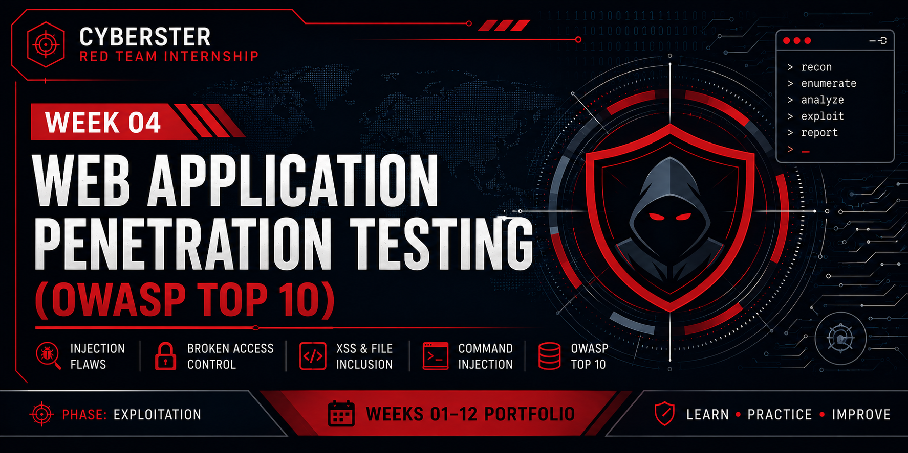

  

# Week 04 – Web Application Penetration Testing (OWASP Top 10)

  

## Overview

This week covered end-to-end web application penetration testing against the OWASP Top 10 vulnerability classes, using industry-standard tooling and methodology. Testing was conducted across two targets, OWASP Mutillidae II (hosted on Metasploitable 2) and DVWA (deployed via Docker), in an isolated lab environment. The engagement demonstrated both the technical mechanics of common web vulnerabilities and the practical red-team workflow of adapting pre-built lab examples to the actual application behavior present in each target.

Four primary tasks were executed: proxy-based HTTP traffic interception and manipulation, SQL injection (manual technique-building followed by automated tooling), operating system command injection, and broken access control (IDOR). Testing also covered client-side attacks (Reflected XSS) and server-side file handling (Local and Remote File Inclusion). The engagement produced eight confirmed, exploitable findings, most critically a fully extractable credential database via SQL Injection, alongside three properly tested negative results that confirm specific security controls are functioning correctly.

Beyond the technical exploits themselves, this week reinforced infrastructure troubleshooting, environment validation, and the discipline of testing what actually exists rather than what a slide assumes exists.

> **Target:** OWASP Mutillidae II on Metasploitable 2 (`<TARGET_IP>`); DVWA (Docker, localhost port 8081)
> **Environment:** Kali Linux (VirtualBox), Burp Suite Community Edition, SQLMap v1.10.6
> **Engagement Type:** Web Application Penetration Testing, OWASP Top 10

**Key Outcome:** Identified 8 confirmed vulnerabilities, including 2 Critical (SQL Injection with full credential extraction, OS Command Injection) and 3 properly tested negative findings demonstrating working controls.

---

# Learning Objectives

- Configured and operated Burp Suite as an intercepting proxy for live traffic manipulation
- Performed HTTP request/response interception and in-flight modification of headers, credentials, and parameters
- Executed manual SQL injection using error-based, boolean-based, and UNION-based techniques
- Automated SQL injection detection and database extraction using SQLMap
- Demonstrated OS command injection via shell separator syntax and command chaining
- Identified and exploited Insecure Direct Object References (IDOR) in application endpoints
- Confirmed Reflected XSS and validated session hijacking attack vectors
- Performed Local File Inclusion (LFI) and tested Remote File Inclusion (RFI) against configuration-level blocking
- Documented both positive findings and properly tested negative results (working security controls)
- Resolved infrastructure challenges (network adapter configuration, Docker deployment, session state validation)

---

# Skills Developed

- Burp Suite Proxy, Repeater, and Intruder workflow and attack modes
- Manual SQL injection payload construction and DBMS fingerprinting
- SQLMap command-line usage, DBMS detection, and data extraction automation
- OS command injection via shell separators and command chaining
- IDOR surface identification and parameter tampering techniques
- XSS payload crafting and JavaScript execution context awareness
- File inclusion traversal, path manipulation, and protocol handling
- VirtualBox network adapter configuration for isolated lab environments
- Docker image deployment and container networking
- Negative testing methodology and documentation of working controls

---

# Tools Used

| Category | Tools |
|----------|-------|
| Proxies & Interceptors | Burp Suite Community Edition v2026.3.2, FoxyProxy Standard (Firefox) |
| Automation & Scanning | SQLMap v1.10.6 |
| Container & Infrastructure | Docker, Python HTTP server (RFI testing), VirtualBox |
| Targets | OWASP Mutillidae II v2.1.19 (Metasploitable 2), DVWA (vulnerables/web-dvwa Docker image) |
| Attacker OS | Kali Linux 2026.1 (VirtualBox) with host-only lab adapter and NAT adapter |

---

# Web Application Penetration Testing Workflow
